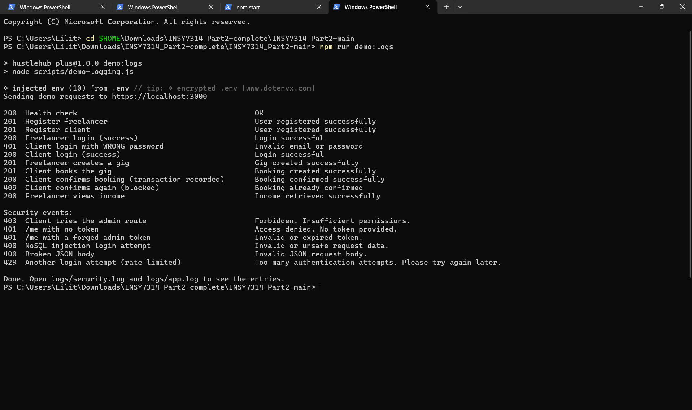

# HustleHub+ — Part 2

HustleHub+ is a secure freelance marketplace. Freelancers advertise services. Clients browse and book those services. Bookings later create simulated payment records so freelancers can see income and estimated tax. Because the platform will hold passwords, identity, and money-related data, security is designed in from the first version, not added afterwards (The Independent Institute of Education, 2026; Open Worldwide Application Security Project, 2021).

Part 2 is the **full MERN product**: MongoDB for users, gigs, bookings, and transactions; a React client on HTTPS; JWT plus RBAC for client, freelancer, and admin; and the Part 1 security controls kept in place.

**Demonstration video:** [HustleHub+ Part 1 demo](https://youtu.be/DcsFY8W7TBE) (Nordien, 2026).

---

## Table of contents

1. [Group members](#group-members)
2. [System and intended users](#system-and-intended-users)
3. [Architecture diagram explained for a non-technical reader](#architecture-diagram-explained-for-a-non-technical-reader)
4. [Backend structure](#backend-structure)
5. [How to run](#how-to-run)
6. [API endpoints](#api-endpoints)
7. [Request flow](#request-flow)
8. [Security decisions](#security-decisions)
9. [Logging and monitoring](#logging-and-monitoring)
10. [Testing, screenshots, and demonstration](#testing-screenshots-and-demonstration)
11. [Reference list](#reference-list)
12. [Disclosure of AI usage in this assessment](#disclosure-of-ai-usage-in-this-assessment)

---

## Group members

| Name | Student number | Role on Part 2 |
| --- | --- | --- |
| **Humera Mathia** (Group Leader) | ST10276384 | Node.js / Express API: gigs, bookings, transactions, HTTPS server, React client, frontend Vitest suite, integration onto `main` |
| **Mohammed Ba Yazed** | ST10174227 | MongoDB users and security: bcrypt, JWT, validation, sanitisation, rate limiting, Helmet/CSP |
| **Lilitha Mlobi** | ST10454944 | Wire the React UI to the live API: auth context, protected routes, gig/booking/income screens |
| **Imraan Nordien** | ST10434419 | Postman collection, Newman runs, API response screenshots, demonstration video |

---

## System and intended users

Imagine a digital marketplace, like a noticeboard plus a cash register. Three kinds of people will use it:

| Who | What they need from the system |
| --- | --- |
| **Client** | Find a service and book it |
| **Freelancer** | List a service, see bookings, later see income and tax |
| **Admin** | Look after the platform |

Part 2 builds the **website, gigs, bookings, and income views**. A person can still **create an account**, **log in**, and prove “it is still me” with a JWT. On top of that, clients book gigs, freelancers manage listings and income, and an admin oversees users. The Independent Institute of Education (2026) requires hashing, tokens, validation, sanitisation, rate limiting, Helmet/CSP, and HTTPS because credentials and money-related records are in play.

Sensitive data in this part is the **email and password**, the **user id and role**, and **booking and transaction records**. Those never travel or sit in storage in a careless way.

Users, gigs, bookings, and transactions are saved in **MongoDB** (`hustlehub` on port `27017`). Hashing and checks still happen **before** anything is written (MongoDB, Inc., 2024). Public registration only allows `client` or `freelancer`; admin accounts are created with `npm run create-admin`.

---

## Architecture diagram explained for a non-technical reader

If you have never built software, treat the picture below as a **three-storey building**. A customer does not walk into the basement filing room. They enter the shop (the website), speak to reception (the API), and only reception is allowed to open the cabinets (storage). That three-storey idea is what industry calls a **tiered** or **MERN** layout.

**MERN** is four tools that fit those storeys (MongoDB, Inc., 2024; OpenJS Foundation, n.d.; Meta Platforms, 2024; OpenJS Foundation, 2024):

| Letter | Tool | Plain English | Where it sits on the diagram |
| --- | --- | --- | --- |
| **M** | MongoDB | A professional database for users, gigs, and bookings | Orange **Data tier** at the bottom |
| **E** | Express | A rulebook: “if someone asks for this address, do this job” | Inside the blue **Server tier** |
| **R** | React | The clickable website in the browser | Green **Client tier** at the top |
| **N** | Node.js | The engine that runs the server | The same blue **Server tier** |

**Figure 1:** HustleHub+ architecture, security features, and system boundaries (authors’ own diagram, 2026).


### Storey 1 — green box: Client tier (React SPA)

This is the **shop window**: the HustleHub+ screen a person would open in Chrome or Edge. “SPA” means single-page application: the page does not fully reload for every click (Meta Platforms, 2024).

**Part 2 status:** this website **is built**. The React SPA lives in `client/` and runs on `https://localhost:5173`. Postman can still send the same messages for API evidence.

**Boundary:** the browser (or Postman) may only talk to the server over **HTTPS**. It must never keep a raw password. After login it may keep a **JWT** in `localStorage` (`hh_token`) — think of a signed, time-limited visitor badge — not the password itself (Jones, Bradley and Sakimura, 2015).

### The arrow between green and blue — HTTPS (TLS)

The arrow labelled **HTTPS (TLS)** is a **locked tunnel** between the shop window and reception. TLS is the lock on that tunnel (Rescorla, 2018). That is why every address starts with `https://localhost:3000`, not `http://`.

Without this arrow, someone on the same Wi-Fi could read a password on login or a token on later requests. Hashing and JWT signing would then be pointless, because the secret would already have been stolen in transit (Rescorla, 2018; Open Worldwide Application Security Project, 2021).

The browser may show “Not secure” for our **self-signed** local certificate. That warning means the computer does not recognise our homemade stamp; the traffic is still encrypted. Postman should use HTTPS and turn SSL certificate verification off for this local stamp.

### Storey 2 — blue box: Server tier (Node.js + Express)

This is **reception**. It is the only part of the building the public is allowed to speak to. The diagram marks this as the **system boundary: reachable only over HTTPS**. Nobody on the internet is allowed to open the user file or, later, MongoDB. They must go through this box (OpenJS Foundation, n.d.; OpenJS Foundation, 2024).

Inside reception the diagram shows three purple desks. A message is handled **in order**:

1. **HTTPS** — the tunnel is opened and the body can be read safely.
2. **Validation** — is the form complete and legal?
3. **Auth & JWT** — if this is a private room, is the visitor badge valid?
4. **Routes & controllers** — do the actual job (register, login, or “who am I?”).
5. **Queries** — ask the filing cabinet to save or find a user.

#### Purple desk: Auth & JWT

On **register**, the password is **hashed** (turned into a one-way scramble) before it is stored (Provos and Mazières, 1999). On **login**, the scramble is compared and the server **issues a token** that carries only `id` and `role` (Jones, Bradley and Sakimura, 2015). On later calls such as `/me`, the same desk checks that badge. If the badge is missing, fake, or expired, the door stays closed.

#### Purple desk: Validation

This desk reads the form **before** any filing happens. Missing name, weak password, bad email, or a role such as `"manager"` is stopped here. Extra unexpected fields are thrown away so nobody can smuggle extra data into storage. Checking at the door means a later piece of code cannot “forget” to check (Open Worldwide Application Security Project, 2021).

#### Purple desk: Routes & controllers

These are the jobs reception is willing to do. The diagram mentions register, login, gigs, and bookings because that is the **full** marketplace. In Part 1 the jobs that exist are:

- register a user
- log in and receive a token
- `/me` — “show me who this badge belongs to”

Gigs and bookings are drawn as future work so the diagram still matches the MERN plan in the brief (The Independent Institute of Education, 2026).

### Storey 3 — orange box: Data tier

This is the **filing cabinet**. The arrow labelled **Queries** is reception asking: “save this user” or “find this email”.

**Part 2:** the cabinet is **MongoDB**, the “M” in MERN (MongoDB, Inc., 2024). Collections hold users, gigs, bookings, and transactions. The green shop and blue reception stay; this floor is no longer a local JSON file.

The cabinet **never** sees a plaintext password. It only ever stores a bcrypt hash. Gigs, bookings, and transactions are queried through Mongoose models in `src/models/`.

### System boundaries (who may touch what)

A **boundary** is a fence. If you ignore the fence, you have no security, only hope.

| Actor | May talk to | Must not talk to |
| --- | --- | --- |
| Browser / Postman (client) | Server, and only over HTTPS | The user file or MongoDB |
| Server (Node + Express) | Client (answers) and storage (queries) | The internet except through HTTPS |
| Storage (file now, MongoDB later) | Server only | The public internet |

**Public rooms** (health, register, login): anyone may knock; they still pass HTTPS and validation.  
**Private rooms** (`/me`, and later gigs or bookings): every knock must show a valid JWT. That is the line on the diagram between “anyone can ask” and “only people with a badge get in”.

---

## Backend structure

```text
hustlehub-plus/
├── Architecture Diagram .png
├── README.md
├── .env.example
├── .gitignore
├── package.json
├── client/                        # React Vite SPA (port 5173)
├── certs/                         # local SSL files (not committed)
├── logs/                          # app.log, security.log, error.log (not committed)
├── docs/logging/                  # logging evidence screenshots
├── tests/
│   └── logging.test.js            # Jest + Supertest logging tests
├── postman/
│   ├── HustleHub-Part1.postman_collection.json
│   └── screenshots/               # Part 1 Postman images
├── scripts/
│   ├── generate-certs.js
│   ├── demo-logging.js            # sends demo requests to fill the logs
│   └── create-admin.js            # bootstrap an admin (not public register)
└── src/
    ├── server.js                  # HTTPS only
    ├── app.js
    ├── config/                    # MongoDB connection
    ├── routes/
    ├── controllers/
    ├── models/                    # user, gig, booking, transaction
    ├── middleware/                # includes requestLogger.js
    └── utils/                     # includes logger.js (Winston)
```

Routes only map addresses. Middleware enforces security before a controller runs. Utils hold hashing and JWT. Models own storage. That split is itself a boundary: validation cannot be skipped by hiding logic in one large file (The Independent Institute of Education, 2026).

---

## How to run

Install [MongoDB Community](https://www.mongodb.com/try/download/community) and start the service so it listens on `27017`. Copy `.env.example` to `.env` and keep `MONGODB_URI=mongodb://127.0.0.1:27017/hustlehub`.

```bash
npm install
copy .env.example .env
npm run certs
npm run dev
```

On macOS or Linux use `cp .env.example .env`.

1. Set a long random `JWT_SECRET` in `.env`. Never commit `.env`.
2. `npm run certs` creates `certs/key.pem` and `certs/cert.pem` (gitignored).
3. The API listens on **`https://localhost:3000`** and talks to MongoDB on **`27017`**.

Health check: `GET https://localhost:3000/api/health`

### React client

The SPA uses Vite with a local HTTPS cert. `VITE_API_URL` defaults to `https://localhost:3000`. Accept the API self-signed certificate in the browser first (open the API health URL once), then start the client:

```bash
cd client
npm install
npm run dev
```

Open **`https://localhost:5173`**. If the browser blocks the Vite cert, proceed past the warning for local development.

### Create an admin

Public `POST /api/auth/register` only accepts `client` or `freelancer`. To bootstrap an admin, set `ADMIN_EMAIL` and `ADMIN_PASSWORD` in `.env` (see `.env.example`) and run:

```bash
npm run create-admin
```

The script hashes the password with bcrypt (12 rounds) and writes a user with role `admin`. Do not expose this as a public signup form.

---

## API endpoints

Base URL: `https://localhost:3000`

| Method | Path | Access | Success |
| --- | --- | --- | --- |
| `GET` | `/api/health` | Public | `200` |
| `POST` | `/api/auth/register` | Public | `201` |
| `POST` | `/api/auth/login` | Public | `200` |
| `GET` | `/api/auth/me` | Bearer JWT | `200` |

Roles: `client` \| `freelancer` \| `admin`

**Success:** `{ "success": true, "message": "...", "data": {} }`  
**Error:** `{ "success": false, "message": "..." }`  
Passwords are never returned in `data`.

### Register

`POST /api/auth/register`

```json
{
  "name": "Ada Lovelace",
  "email": "ada@test.com",
  "password": "Secret123!",
  "role": "client"
}
```

Password must be 8–128 characters and include uppercase, lowercase, a number, and a special character (Grassi, Garcia and Fenton, 2017).

| Case | Status |
| --- | --- |
| Missing or invalid fields | `400` |
| Weak password | `400` |
| Invalid role | `400` |
| Duplicate email | `409` |

### Login

`POST /api/auth/login`

```json
{
  "email": "ada@test.com",
  "password": "Secret123!"
}
```

| Case | Status |
| --- | --- |
| Missing fields | `400` |
| Unknown email or wrong password | `401` (same message for both) |

`data` includes `token` and `user`.

### Current user (protected)

`GET /api/auth/me`  
Header: `Authorization: Bearer <token>`

This is the Part 1 route **beyond login**. The JWT is validated on **every** call (The Independent Institute of Education, 2026; Jones, Bradley and Sakimura, 2015).

| Case | Status |
| --- | --- |
| No token | `401` |
| Invalid or expired token | `401` |

---

## Request flow

**Register:** HTTPS → `validateRegister` → duplicate-email check → `hashPassword` → `createUser` → `201` without password.

**Login:** HTTPS → `validateLogin` → find user → `comparePassword` → `signToken({ id, role })` → `200` with token.

**Protected `/me`:** HTTPS → `authMiddleware` reads `Bearer` → `verifyToken` → `findById` → `200` without password.

Failures return controlled JSON. Stack traces, file paths, and configuration values are not sent (Open Worldwide Application Security Project, 2021).

---

## Security decisions

The brief asks not only **what** was used, but **why** (The Independent Institute of Education, 2026).

### Password hashing

**What:** Passwords are hashed with **bcryptjs, 12 salt rounds** before save. Login uses `bcrypt.compare`. Plaintext is never stored or returned (Provos and Mazières, 1999).

**Why:** If `users.json` leaks, a slow salted hash is expensive to reverse. Rainbow tables fail because each password gets its own salt. A fast hash (MD5, SHA-1) or plaintext would turn one stolen file into a full takeover (Provos and Mazières, 1999; Open Worldwide Application Security Project, 2021). Twelve rounds is slow enough for attackers and still acceptable for register and login. Hashing happens **before** the model writes the file.

### Token-based authentication (JWT)

**What:** Login returns a JWT signed with `JWT_SECRET` from `.env`. The payload is only `id` and `role`. Protected routes send `Authorization: Bearer <token>`. `authMiddleware` verifies the token on **every** protected request (Jones, Bradley and Sakimura, 2015).

**Why:** The API stays **stateless**: the server does not keep a session table. Signing means a client cannot change `id` or `role` without breaking the signature. A small payload limits what is exposed if a token is stolen. The secret is not in GitHub. Checking every time stops `/me` from being called with a missing, expired, or forged token.

### Input validation

**What:** `validateRegister` and `validateLogin` run before controllers. They require the right fields, a real email, a strong password, an allowed role, and they reject unexpected fields.

**Why:** The API is the first place an attacker can send data. One door policy means a controller cannot skip checks (Open Worldwide Application Security Project, 2021). A weak password is refused because hashing a guessable password still leaves the account easy to break (Grassi, Garcia and Fenton, 2017). Login uses one message, `"Invalid email or password"`, so the API does not confirm whether an email is registered.

### HTTPS

**What:** `src/server.js` always uses `https.createServer` with a local certificate. There is no HTTP fallback.

**Why:** Hashing and JWT do not help if the password or token crosses the network in clear text (Rescorla, 2018). Serving HTTPS in development also finds certificate mistakes now, not only in production.

### Controlled error handling

**What:** Unexpected errors return `{ success: false, message: "Something went wrong" }`. Unknown URLs return JSON `404`. JSON responses use `Cache-Control: no-store` so tokens and user records are not cached.

**Why:** Raw errors can leak stack traces, paths, or configuration and help an attacker map the server (Open Worldwide Application Security Project, 2021).

### Rate limiting, Helmet, and sanitisation

**What:** Auth routes are limited to 5 requests per 15 minutes. Booking routes are limited to 10 per 15 minutes. Helmet sets CSP. Request bodies are sanitised before controllers run.

**Why:** Brute-force login and booking spam are slowed at the door. CSP reduces XSS impact in the browser. Sanitisation strips unexpected or dangerous input so Mongo queries and HTML views do not receive raw attacker strings (Open Worldwide Application Security Project, 2021).

### Public register cannot create admin

**What:** `validateRegister` and the auth controller only allow `client` or `freelancer`. The React register form has no Admin option. Admin accounts are created with `npm run create-admin`.

**Why:** An open signup that accepts `admin` would let anyone grant themselves platform privileges. Privilege must be issued by an operator, not by the public form.

---

## Logging and monitoring

### What was built

**What:** The API uses **Winston** for structured logging (Winston, 2024). All logging goes through one module, `src/utils/logger.js`. Each entry is one line of JSON with a timestamp, level, event name, request ID, user ID, role, IP address, method, and path. JSON lines can be searched with tools like `grep` or `jq` and imported into a log platform later without rewriting the code.

| Output | What it holds | Why it is separate |
| --- | --- | --- |
| Console (stdout) | Every entry | `docker compose logs api` shows the logs when the API runs in a container. |
| `logs/app.log` | Every entry at `LOG_LEVEL` and above | Full history: requests, security events, bookings, transactions, errors. |
| `logs/security.log` | Security events only (`category: "security"`) | A reviewer can check suspicious activity without reading normal traffic. |
| `logs/error.log` | Errors only | Failures stand out straight away. |

Files rotate at 5 MB and keep 5 old files, so logs cannot fill the disk. The `logs/` folder is gitignored. `LOG_LEVEL`, `LOG_DIR`, and `TRUST_PROXY` are set in `.env` (see `.env.example`).

**Request IDs:** `src/middleware/requestLogger.js` gives every request a random UUID. The API returns it in the `X-Request-Id` header, and every log line for that request carries the same ID. If a user reports "something went wrong", their request ID finds the matching access, security, and error lines. For example, a booking confirmation and the transaction it creates share one request ID.

### What is logged

| Event | Level | Where it is logged | Key fields |
| --- | --- | --- | --- |
| `http.request` | info / warn (4xx) / error (5xx) | `requestLogger.js`, every request | method, path, status, durationMs, ip, userId |
| `auth.login.success` | info | `authController.login` | userId, role, masked email |
| `auth.login.failure` | warn | `authController.login` | reason (`unknown_email` or `wrong_password`), masked email |
| `auth.register.success` / `auth.register.rejected` | info / warn | `authController.register` | reason (`duplicate_email`, `invalid_role`), requested role |
| `auth.token.missing` / `auth.token.invalid` | warn | `authMiddleware` | reason (`expired`, `bad_signature_or_malformed`, `missing_claims`) |
| `access.denied` | warn | `roleMiddleware`, `requireGigOwner`, booking confirm | reason (`wrong_role`, `not_gig_owner`, `not_booking_owner`), resource ID, owner ID |
| `rate_limit.exceeded` | warn | `rateLimitMiddleware` | limiter (`auth` or `booking`) |
| `input.unsafe_rejected` | warn | `sanitiseMiddleware` | reason (`mongo_operator_key`) |
| `gig.created` / `gig.updated` / `gig.deleted` | info | `gigController` | gigId, price, gigCategory |
| `booking.created` | info | `bookingController.create` | bookingId, gigId, clientId, freelancerId, amount |
| `booking.create.failed` / `booking.confirm.failed` | warn | `bookingController` | reason (`gig_not_found`, `booking_not_found`, `already_confirmed`) |
| `booking.confirmed` | info | `bookingController.confirm` | bookingId, clientId, freelancerId |
| `transaction.recorded` | info | `bookingController.confirm` | transactionId, bookingId, amount, clientId, freelancerId |
| `transaction.duplicate_blocked` | warn | `bookingController.confirm` | bookingId, existing transactionId |
| `transaction.income_viewed` | info | `transactionController` | transactionCount, totalIncome |
| `error.unhandled` | error | `errorMiddleware` | errorName, errorMessage, stack, requestId |
| `request.invalid_json` | warn | `errorMiddleware` | requestId, path |
| `server.started`, `db.connected`, `db.disconnected`, `db.error`, `process.uncaught_exception`, `process.unhandled_rejection` | info–error | `server.js`, `config/db.js` | port, host, database name, error details |

### What is never logged

Logs are a common target, so they must not become a second copy of user secrets (Open Worldwide Application Security Project, n.d.).

- **Passwords, JWTs, and secrets** are never passed to the logger. As a backstop, the logger replaces any field named `password`, `token`, `authorization`, `jwt`, `secret`, or `cookie` with `[REDACTED]`.
- **Email addresses are masked** (`li***@example.com`). The masked form is still enough to spot several failed logins against one account.
- **Request bodies and headers are not logged.** Query strings are removed from the path, so a token sent in a URL cannot reach the log.
- **The MongoDB URI is not logged** because it can contain credentials. Only the host and database name are.
- **Line breaks and control characters are stripped** from logged strings. This stops log injection, where an attacker puts a newline in an input field to forge a fake log line.
- **Stack traces stay on the server.** `error.log` keeps the stack for debugging, while the client still only receives `"Something went wrong"`.

### Why these logs matter for monitoring and security

Security logging and monitoring failures are listed as A09 in the OWASP Top 10. Without logs, an attack can go on for weeks with nothing to show it happened or how far it got (Open Worldwide Application Security Project, 2021).

- **Login attempts:** Many `auth.login.failure` entries with `wrong_password` against one masked email suggest someone is guessing that account's password. Many `unknown_email` failures from one IP suggest someone is testing a list of stolen emails. The client always receives the same generic message, so attackers learn nothing, but the server keeps the exact reason. `auth.login.success` after a run of failures from the same IP is the most important line to check, because it may mean a guess worked.
- **Tokens and access control:** `auth.token.invalid` with `bad_signature_or_malformed` means someone sent a forged or edited JWT, for example to change their role to `admin`. `access.denied` shows broken access control attempts, such as a client calling an admin route or confirming another client's booking (A01 in the OWASP Top 10). Each line names the user ID, so repeat offenders can be identified.
- **Bookings and transactions:** HustleHub+ records money-related events. `booking.created`, `booking.confirmed`, and `transaction.recorded` form an audit trail showing who booked what, who confirmed it, the amount, and when. That trail can settle a dispute between a client and a freelancer and helps check that income totals are right. `transaction.duplicate_blocked` shows attempts to be charged or paid twice for one booking.
- **Abuse and injection:** `rate_limit.exceeded` shows automated attacks hitting the limiter. `input.unsafe_rejected` records NoSQL injection payloads such as `{"$ne": null}` that the sanitiser blocked, showing the protection is being tested and is working.
- **Errors:** `error.unhandled` with a stack and request ID lets the team find and fix a fault quickly. A sudden rise in `error.unhandled` or `db.error` lines is an early sign of an outage or of an attacker sending inputs that crash the API.

**Using the logs:** Because each line is JSON, simple commands answer monitoring questions:

```bash
# Failed logins, newest last
grep '"auth.login.failure"' logs/security.log

# Every action in one request
grep '<request-id>' logs/app.log

# Count failed logins per IP (needs jq)
jq -r 'select(.event=="auth.login.failure") | .ip' logs/security.log | sort | uniq -c | sort -rn
```

In Docker, mount the folder so logs survive container restarts, and set `TRUST_PROXY=true` if a proxy sits in front of the API so the real client IP is logged:

```yaml
  api:
    volumes:
      - ./logs:/app/logs
```

### Logging tests

`tests/logging.test.js` (Jest and Supertest) runs the real Express app with the Mongo models mocked. There are 19 tests. They check that every event above is written with the right fields, that the access log omits query strings, and that passwords and forged tokens never reach the logger. They also check that the 500 response hides the error while the log keeps it, and that redaction strips secrets and line breaks.

```bash
npm test
```

### Generating log evidence

With the API running (`npm run dev`), a second terminal can run:

```bash
npm run demo:logs
```

`scripts/demo-logging.js` sends a realistic sequence of requests to the API. It registers a freelancer and a client, logs in with a wrong password and then the right one, creates a gig, books it, confirms it (which records a transaction), and tries to confirm it again. It then sends blocked requests: a client calling an admin route, a missing token, a forged admin token, a NoSQL injection payload, broken JSON, and one login too many for the rate limiter. Each step prints its HTTP status, and the matching entries appear in `logs/security.log` and `logs/app.log`. The auth limiter allows five register and login requests per 15 minutes, so wait 15 minutes before running it again.

### Logging evidence

The lines below are copied from the log files after running `npm run demo:logs` against the API connected to MongoDB Atlas on 7 November 2026. Passwords and tokens appear nowhere, and email addresses are masked.

**`logs/security.log`:** a wrong password followed by a successful login, a client calling an admin route, a forged JWT, a blocked NoSQL injection payload, and the rate limiter stopping a sixth login attempt:

```json
{"timestamp":"2026-11-07T01:29:16.438Z","level":"warn","event":"auth.login.failure","category":"security","requestId":"22b3131b-8ec1-41f4-b44f-ea9e5c6ef4b9","ip":"::1","method":"POST","path":"/api/auth/login","reason":"wrong_password","email":"cl***@example.com","targetUserId":"6aee7eeb45b22ffc575fedc7","service":"hustlehub-api"}
{"timestamp":"2026-11-07T01:29:16.785Z","level":"info","event":"auth.login.success","category":"security","requestId":"5f680adf-597c-4f67-ad57-d15457a4e070","ip":"::1","method":"POST","path":"/api/auth/login","userId":"6aee7eeb45b22ffc575fedc7","role":"client","email":"cl***@example.com","service":"hustlehub-api"}
{"timestamp":"2026-11-07T01:29:16.929Z","level":"warn","event":"access.denied","category":"security","requestId":"2d674aea-bf64-4105-a3d1-5442e93cc5ec","ip":"::1","method":"GET","path":"/api/admin/gigs","userId":"6aee7eeb45b22ffc575fedc7","role":"client","reason":"wrong_role","requiredRole":"admin","service":"hustlehub-api"}
{"timestamp":"2026-11-07T01:29:16.942Z","level":"warn","event":"auth.token.invalid","category":"security","requestId":"a4598234-8ee2-46e5-9781-df21494eac56","ip":"::1","method":"GET","path":"/api/auth/me","reason":"bad_signature_or_malformed","service":"hustlehub-api"}
{"timestamp":"2026-11-07T01:29:16.948Z","level":"warn","event":"input.unsafe_rejected","category":"security","requestId":"7094f2c4-9171-4049-b5a7-aa6dff20aab6","ip":"::1","method":"POST","path":"/api/auth/login","reason":"mongo_operator_key","service":"hustlehub-api"}
{"timestamp":"2026-11-07T01:29:16.963Z","level":"warn","event":"rate_limit.exceeded","category":"security","requestId":"a6a548f8-2264-4dac-8e4e-968f07643276","ip":"::1","method":"POST","path":"/api/auth/login","limiter":"auth","service":"hustlehub-api"}
```

**`logs/app.log`:** the booking and transaction audit trail. The confirmation and the transaction share one `requestId`, and the second confirmation attempt is refused:

```json
{"timestamp":"2026-11-07T01:29:16.840Z","level":"info","event":"booking.created","category":"audit","requestId":"28040bd2-1f00-4d19-bb1f-386acfafb946","ip":"::1","method":"POST","path":"/api/bookings","userId":"6aee7eeb45b22ffc575fedc7","role":"client","bookingId":"6aee7eec45b22ffc575fedc9","gigId":"6aee7eec45b22ffc575fedc8","clientId":"6aee7eeb45b22ffc575fedc7","freelancerId":"6aee7eeb45b22ffc575fedc6","amount":750,"status":"pending","service":"hustlehub-api"}
{"timestamp":"2026-11-07T01:29:16.891Z","level":"info","event":"booking.confirmed","category":"audit","requestId":"5979151b-43e9-45ce-8325-5705ce217b41","ip":"::1","method":"POST","path":"/api/bookings/6aee7eec45b22ffc575fedc9/confirm","userId":"6aee7eeb45b22ffc575fedc7","role":"client","bookingId":"6aee7eec45b22ffc575fedc9","gigId":"6aee7eec45b22ffc575fedc8","clientId":"6aee7eeb45b22ffc575fedc7","freelancerId":"6aee7eeb45b22ffc575fedc6","service":"hustlehub-api"}
{"timestamp":"2026-11-07T01:29:16.892Z","level":"info","event":"transaction.recorded","category":"audit","requestId":"5979151b-43e9-45ce-8325-5705ce217b41","ip":"::1","method":"POST","path":"/api/bookings/6aee7eec45b22ffc575fedc9/confirm","userId":"6aee7eeb45b22ffc575fedc7","role":"client","transactionId":"6aee7eec45b22ffc575fedca","bookingId":"6aee7eec45b22ffc575fedc9","gigId":"6aee7eec45b22ffc575fedc8","clientId":"6aee7eeb45b22ffc575fedc7","freelancerId":"6aee7eeb45b22ffc575fedc6","amount":750,"type":"booking","service":"hustlehub-api"}
{"timestamp":"2026-11-07T01:29:16.905Z","level":"warn","event":"booking.confirm.failed","category":"audit","requestId":"143da856-c015-4b28-85d8-c367d68a63d7","ip":"::1","method":"POST","path":"/api/bookings/6aee7eec45b22ffc575fedc9/confirm","userId":"6aee7eeb45b22ffc575fedc7","role":"client","reason":"already_confirmed","bookingId":"6aee7eec45b22ffc575fedc9","service":"hustlehub-api"}
{"timestamp":"2026-11-07T01:29:16.920Z","level":"info","event":"transaction.income_viewed","category":"audit","requestId":"c7f037f5-8af1-4f15-aedd-0e23a12216bf","ip":"::1","method":"GET","path":"/api/transactions/mine","userId":"6aee7eeb45b22ffc575fedc6","role":"freelancer","transactionCount":1,"totalIncome":750,"service":"hustlehub-api"}
```

**`logs/error.log`:** a startup failure recorded while the database was unreachable (the computer's IP had not yet been added to the Atlas access list):

```json
{"timestamp":"2026-11-07T00:29:35.161Z","level":"error","event":"db.connect.failed","category":"error","errorName":"MongooseServerSelectionError","errorMessage":"Could not connect to any servers in your MongoDB Atlas cluster. One common reason is that you're trying to access the database from an IP that isn't whitelisted. Make sure your current IP address is on your Atlas cluster's IP whitelist: https://www.mongodb.com/docs/atlas/security-whitelist/","service":"hustlehub-api"}
```

**Demo script output:** every request sent by `npm run demo:logs` and the status the API returned. Each line matches one of the log entries above.



---

## Frontend tests

The React client uses **Vitest** and React Testing Library (`jsdom`). Tests cover login, register, gig list/detail/create/edit, bookings, income, admin, layout, protected routes, and shared components.

From the repo root:

```bash
npm run test:client
```

Or from `client/`:

```bash
npm test
```

Coverage output is gitignored (`client/coverage/`).

---

## Testing, screenshots, and demonstration

Imraan Nordien (ST10434419) produced the Postman collection (`postman/HustleHub-Part1.postman_collection.json`), the twelve screenshots below, and the demonstration video.

**Demonstration video:** [https://youtu.be/DcsFY8W7TBE](https://youtu.be/DcsFY8W7TBE) (Nordien, 2026). The recording shows the API running over HTTPS, successful registration, and login with token generation, as required by The Independent Institute of Education (2026).

### 1. Health — API is running (`200`)

`GET /api/health` proves the server is up over HTTPS.


### 2. Register — success (`201`)

A valid body creates a user. The password is not returned.


### 3. Register — missing fields (`400`)

Name is omitted. Validation rejects the request before storage.


### 4. Register — weak password (`400`)

`secret123` has no uppercase letter (Grassi, Garcia and Fenton, 2017).


### 5. Register — invalid role (`400`)

`"manager"` is not allowed. Only `client`, `freelancer`, or `admin`.


### 6. Register — duplicate email (`409`)

The same email cannot register twice.


### 7. Login — success and JWT (`200`)

Correct credentials return a token (Jones, Bradley and Sakimura, 2015).


### 8. Login — missing fields (`400`)

Password omitted. Validation runs before login logic.


### 9. Login — invalid credentials (`401`)

Wrong password. The message does not reveal whether the email exists.


### 10. Protected `/me` — no token (`401`)

The route beyond login refuses callers with no JWT.


### 11. Protected `/me` — invalid token (`401`)

`Bearer badtoken` is rejected. The token is checked on every protected request.


### 12. Protected `/me` — valid token (`200`)

The login token identifies the user. The password is still not returned.


---

## Reference list

Cursor, 2026. *Cursor*. [generative AI coding assistant]. Available at: <https://www.cursor.com/> [Accessed 9 October 2026].

Grassi, P.A., Garcia, M.E. and Fenton, J.L., 2017. *Digital identity guidelines: authentication and lifecycle management*. NIST Special Publication 800-63B. [online] Gaithersburg: National Institute of Standards and Technology. Available at: <https://doi.org/10.6028/NIST.SP.800-63B> [Accessed 6 September 2026].

Jones, M., Bradley, J. and Sakimura, N., 2015. *JSON web token (JWT)*. RFC 7519. [online] Internet Engineering Task Force. Available at: <https://www.rfc-editor.org/rfc/rfc7519> [Accessed 6 September 2026].

Meta Platforms, 2024. *React*. [online] Available at: <https://react.dev/> [Accessed 6 September 2026].

MongoDB, Inc., 2024. *Introduction to MongoDB*. [online] Available at: <https://www.mongodb.com/docs/manual/introduction/> [Accessed 6 September 2026].

Nordien, I., 2026. *HustleHub+ Part 1 demonstration*. [video online] Available at: <https://youtu.be/DcsFY8W7TBE> [Accessed 6 September 2026].

OpenJS Foundation, 2024. *Node.js documentation*. [online] Available at: <https://nodejs.org/docs/latest/api/> [Accessed 6 September 2026].

OpenJS Foundation, n.d. *Express — fast, unopinionated, minimalist web framework for Node.js*. [online] Available at: <https://expressjs.com/> [Accessed 6 September 2026].

Open Worldwide Application Security Project, n.d. *Logging cheat sheet*. [online] OWASP Cheat Sheet Series. Available at: <https://cheatsheetseries.owasp.org/cheatsheets/Logging_Cheat_Sheet.html> [Accessed 5 November 2026].

Open Worldwide Application Security Project, 2021. *OWASP top 10:2021*. [online] Available at: <https://owasp.org/Top10/2021/> [Accessed 6 September 2026].

Provos, N. and Mazières, D., 1999. A future-adaptable password scheme. *Proceedings of the FREENIX Track: 1999 USENIX Annual Technical Conference*. Monterey, United States of America, 6–11 June 1999. Berkeley: USENIX Association. Available at: <https://www.usenix.org/legacy/events/usenix99/provos.html> [Accessed 6 September 2026].

Rescorla, E., 2018. *The transport layer security (TLS) protocol version 1.3*. RFC 8446. [online] Internet Engineering Task Force. Available at: <https://www.rfc-editor.org/rfc/rfc8446> [Accessed 6 September 2026].

The Independent Institute of Education, 2025. *Guidelines for responsible AI use at The IIE*. [pdf] [s.l.]: The Independent Institute of Education.

The Independent Institute of Education, 2026. *Information systems 3D / Application development security: POE (paper and marking rubric)*. [pdf] [s.l.]: The Independent Institute of Education.

Winston, 2024. *winston: a logger for just about everything*. [online] GitHub. Available at: <https://github.com/winstonjs/winston> [Accessed 5 November 2026].

---

## Disclosure of AI usage in this assessment

This annexure follows The IIE’s labelling and disclosure rules for generative AI (The Independent Institute of Education, 2025).

**Section(s) of the assessment where AI was used:** Git merges and branch integration (Humera, Mo, Lilitha, and `main`), not the written security rationale or the original application design.

**Name of AI tool(s) used:** Cursor (Cursor, 2026).

**Purpose / intention behind use:** The group used Cursor to **understand merge conflicts** and to **sort conflicts and branches**. Several people were committing to the same repository. We did not want to delete someone else’s code by mistake while accepting or rejecting conflict markers. Cursor was used as a second pair of eyes to explain what each side of a conflict meant so we could keep the correct Humera, Mo, and Lilitha work. We reviewed every suggested resolution before it was committed. Cursor did not replace group decisions, and we remain responsible for the quality and integrity of this submission (The Independent Institute of Education, 2025).

**Date(s) on which generative AI was used:** September–October 2026, during branch merges onto `Humera` and `main`.

**Chat record:** Cursor chats are stored in the local Cursor session used by the group leader. There is no public shareable chat URL. Direct AI wording was not copied into this README or into production code as an unreviewed block.
